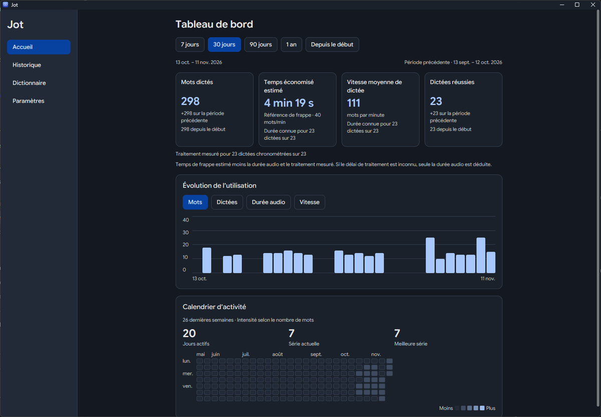
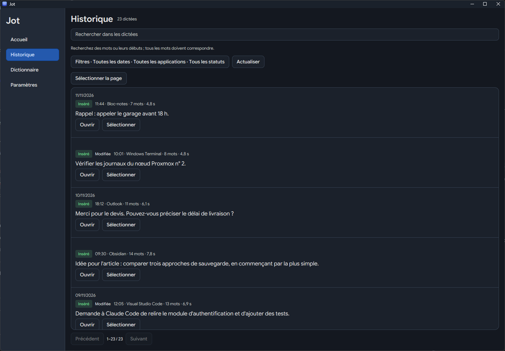
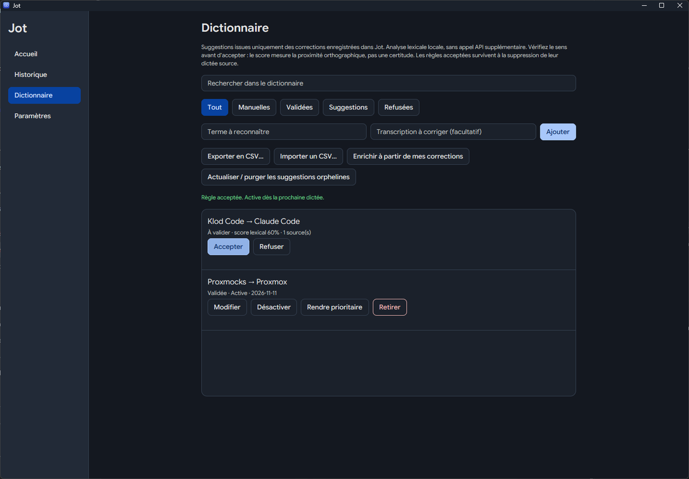
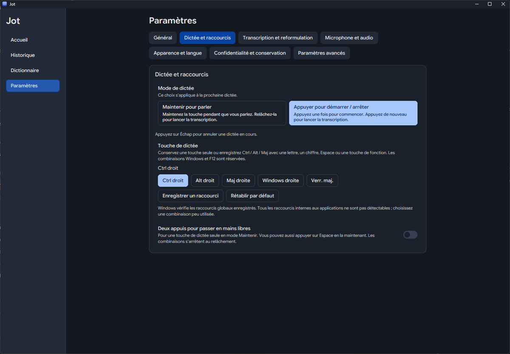

# Jot pour Windows

**Dictée vocale pour Windows : appuyez sur une touche, parlez, et le texte arrive là où se trouve votre curseur.**
Gratuit, open source (Apache 2.0), écrit en Rust avec [GPUI](https://www.gpui.rs).

> **Code source disponible — première version stable non encore publiée.**
> Ce dépôt (fork de [ubranch/jot-gemini-transcribe-Windows](https://github.com/ubranch/jot-gemini-transcribe-Windows))
> ne propose pas encore de version téléchargeable ni d’installeur. Pour l’essayer aujourd’hui, il faut
> [le compiler depuis les sources](#installation-depuis-les-sources). Les versions publiées par d’autres
> dépôts ne correspondent pas à ce code.

<p align="center">
  
</p>

## Ce que fait Jot

1. Vous appuyez sur la **touche de dictée** (Ctrl droit par défaut) dans n’importe quelle application.
2. Vous parlez. Une petite pastille en bas de l’écran indique que Jot écoute ; elle ne capte jamais vos clics.
3. Vous appuyez de nouveau (mode *Toggle*) ou relâchez la touche (mode *Maintenir*).
4. Jot transcrit, nettoie le texte (hésitations, autocorrections orales, ponctuation) et l’insère dans
   l’application où vous étiez. **Échap** annule une dictée en cours.

Chaque dictée est conservée dans l’historique, avec sa transcription brute et vos éventuelles corrections.

## Fonctions de la version 1.4

| Fonction | Détail |
| --- | --- |
| Deux modes de dictée | **Appuyer pour démarrer / arrêter** (Toggle) ou **Maintenir pour parler**. Échap annule. |
| Raccourci personnalisable | Ctrl droit, Alt droit, Maj droite, Windows droite, Verr. maj., ou une combinaison Ctrl/Alt/Maj + lettre, chiffre, Espace ou F1–F24 (hors F12). Un conflit signalé par Windows est refusé et l’ancien raccourci est conservé. |
| Pastille (HUD) | Visible pendant la dictée, traversante pour la souris, ne vole jamais le focus. |
| Insertion | Saisie dans le champ actif, puis collage protégé, puis presse-papiers en dernier recours. Jamais dans un champ mot de passe. |
| Historique | Recherche plein texte (SQLite FTS5), filtres par date, application et statut, correction d’une dictée avec conservation des versions. |
| Dictionnaire intelligent | Suggestions calculées **localement** à partir de vos corrections ; aucune règle n’est activée sans votre validation. Les refus sont mémorisés. Import/export CSV. |
| Tableau de bord | Mots dictés, vitesse, séries d’activité et **temps économisé estimé** (comparé à une vitesse de frappe de référence réglable). |
| Interface | Français ou anglais, thème clair ou sombre. |
| Clé API | Stockée dans le **Gestionnaire d’identification Windows**, jamais dans un fichier de réglages. |

<table>
  <tr>
    <td></td>
    <td></td>
  </tr>
  <tr>
    <td align="center"><sub>Historique (données fictives)</sub></td>
    <td align="center"><sub>Dictionnaire intelligent (données fictives)</sub></td>
  </tr>
</table>

## Prérequis

- Windows 10 ou 11, 64 bits, avec un microphone.
- Pour la dictée actuelle : une **clé API Gemini** ([Google AI Studio](https://aistudio.google.com/apikey)).
  Un compte Google est nécessaire et les conditions et tarifs de Google s’appliquent ; un niveau gratuit existe.
- Pour compiler : la chaîne Rust indiquée dans `rust-toolchain.toml` (actuellement 1.97) et les outils
  de compilation MSVC (Visual Studio Build Tools, charge de travail « Développement Desktop en C++ »).

## Gemini (en ligne) et mode local

**Aujourd’hui (1.4), la transcription passe par l’API Gemini de Google.** Un mode **100 % local**
(transcription et reformulation exécutées sur votre PC, sans clé ni connexion) est en cours de
développement pour une version 1.5. Il n’est **pas encore publié** ; cette section sera mise à jour
quand il le sera.

## Installation depuis les sources

```powershell
git clone https://github.com/tadikwa/jot-gemini-transcribe-Windows
cd jot-gemini-transcribe-Windows
cargo build --release -p jot --locked
.\target\release\jot.exe
```

Jot fonctionne alors en mode portable : pas d’installeur, données dans `%LOCALAPPDATA%\Jot`.
Le binaire n’est pas signé : Windows SmartScreen peut afficher un avertissement.

Au premier lancement, un assistant vous guide jusqu’à la saisie de votre clé Gemini. Le bouton
**Obtenir une clé API Gemini** (dans l’assistant et dans *Paramètres → Confidentialité et
conservation*) ouvre la page de Google AI Studio.

<p align="center">
  
</p>

## Confidentialité

Ce qui suit décrit le comportement du code de ce dépôt ; vérifiez-le si c’est important pour vous.

- **Pendant une dictée Gemini**, Jot envoie à l’API Gemini de Google, avec **votre** clé :
  l’enregistrement audio (WAV) et les termes de votre dictionnaire (2 Ko au plus) pour améliorer leur
  reconnaissance. Si vous activez la passe de reformulation optionnelle, le texte transcrit est aussi
  envoyé. Le traitement de ces données relève des conditions de Google.
- **Aucun serveur intermédiaire**, aucun compte Jot, aucune télémétrie, aucun enregistrement des
  frappes clavier.
- **La seule autre connexion** est la vérification de version, faite uniquement quand vous ouvrez la
  fenêtre *À propos* : elle demande à GitHub la dernière version publiée de ce dépôt.
- Sur votre PC : l’audio est conservé 7 jours par défaut (durée réglable), les transcriptions jusqu’à
  ce que vous les supprimiez, le tout dans `%LOCALAPPDATA%\Jot`. Les journaux ne contiennent jamais
  le texte dicté.
- Le dictionnaire intelligent analyse vos corrections **localement**, sans appel réseau.

## Démarrage automatique

*Paramètres → Général → Lancer au démarrage de Windows* ajoute une entrée pour votre seul compte
utilisateur (clé `Run` de `HKEY_CURRENT_USER`, sans droits administrateur), visible et désactivable
dans le Gestionnaire des tâches → Démarrage. Une copie de test portable (fichier `jot-test-profile`
à côté de `jot.exe`) ne modifie jamais ce réglage.

## Limites connues

- Pas encore de version publiée ni d’installeur ; binaire non signé.
- La qualité de transcription dépend du modèle Gemini et de votre micro ; relisez avant d’envoyer.
- Le temps économisé est une **estimation** fondée sur une vitesse de frappe de référence.
- Les raccourcis internes aux autres applications ne sont pas tous détectables ; choisissez une
  combinaison peu utilisée.
- Windows n’a pas de touche `fn` accessible aux applications : la touche par défaut est Ctrl droit.

## Développement

```powershell
cargo fmt --all --check
cargo clippy --workspace --all-targets --locked -- -D warnings
cargo test --workspace --locked
$env:JOT_LOG = "jot=debug,jot_core=debug"; cargo run -p jot
```

- `crates/jot-core/` : moteur sans interface (raccourcis, capture audio, client Gemini, validation,
  insertion, historique, dictionnaire, statistiques), testable sans lancer l’application.
- `crates/jot/` : application GPUI (pastille, fenêtres, paramètres, icône de notification).
- `docs/` : notes de conception et rapports de validation des versions successives.

## Licence et crédits

Apache 2.0 — voir [LICENSE](LICENSE) et [THIRD_PARTY_NOTICES.md](THIRD_PARTY_NOTICES.md)
(polices Google Sans Flex et Google Sans Code sous SIL OFL 1.1).

- Application d’origine : [Jot pour macOS](https://github.com/google-gemini/jot-gemini-transcribe-macOS),
  par Ammaar Reshi.
- Portage Windows en Rust/GPUI : [ubranch/jot-gemini-transcribe-Windows](https://github.com/ubranch/jot-gemini-transcribe-Windows).
- Ce fork ajoute notamment l’interface française, le mode Toggle, l’historique avancé, le tableau de
  bord, le dictionnaire intelligent et les raccourcis personnalisables.

Jot n’est pas un produit officiellement pris en charge par Google. « Google » et « Gemini » sont des
marques de Google LLC.
