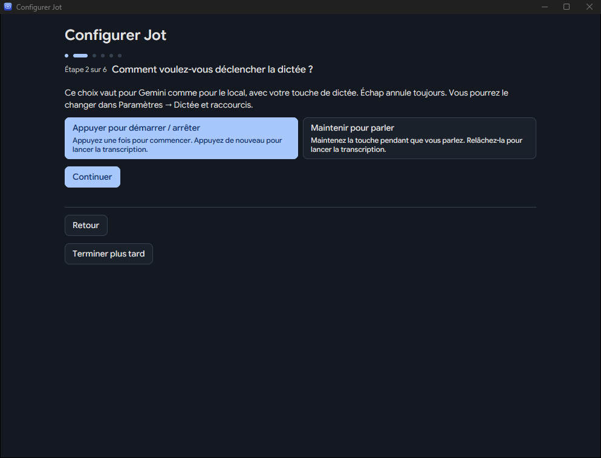
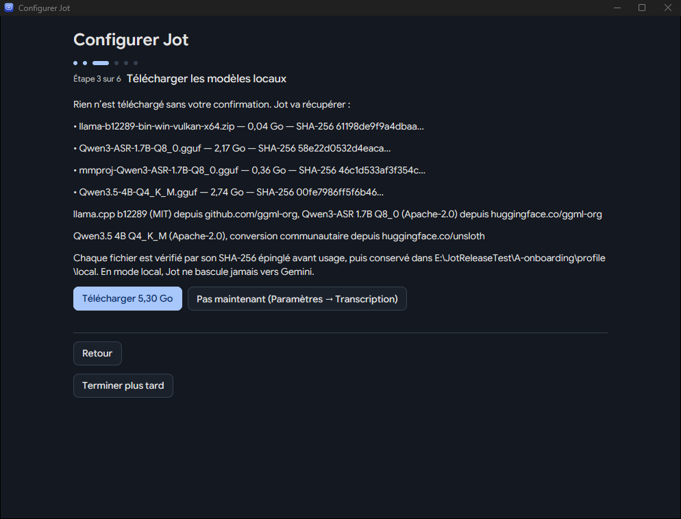
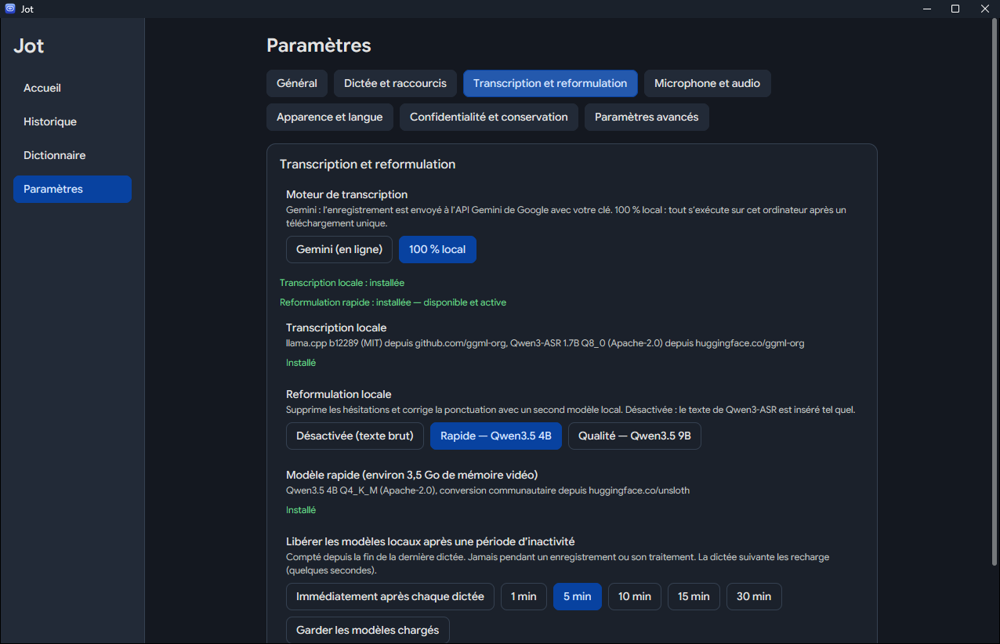

# Jot pour Windows

**Dictée vocale pour Windows : appuyez sur une touche, parlez, et le texte arrive là où se trouve votre curseur.**
Transcription par Gemini ou **entièrement sur votre PC**, reformulation intelligente, historique et
raccourcis personnalisables. Gratuit, open source (Apache 2.0), écrit en Rust avec [GPUI](https://www.gpui.rs).

**[Télécharger Jot 1.7.0](https://github.com/tadikwa/JOT/releases/latest)** :
installateur ou version portable, Windows 10/11 64 bits. La [page de la version 1.5.0](https://github.com/tadikwa/JOT/releases/tag/v1.5.0)
contient une vidéo de démonstration d’une minute.

<p align="center">
  
</p>

## Ce que fait Jot

1. Vous appuyez sur la **touche de dictée** (Ctrl droit par défaut) dans n’importe quelle application.
2. Vous parlez. Une petite pastille en bas de l’écran indique que Jot écoute ; elle ne capte jamais vos clics.
3. Vous appuyez de nouveau (mode *Toggle*) ou relâchez la touche (mode *Maintenir pour parler*).
4. Jot transcrit, nettoie le texte (hésitations, autocorrections orales, ponctuation, listes) et l’insère
   dans l’application où vous étiez. **Échap** annule une dictée en cours.

Chaque dictée est conservée dans l’historique, avec sa transcription brute et vos éventuelles corrections.

## Nouveautés de la version 1.5

- **Mode 100 % local** : transcription (Qwen3-ASR 1.7B) et reformulation (Qwen3.5 4B, ou 9B en option)
  exécutées sur votre PC par [llama.cpp](https://github.com/ggml-org/llama.cpp). Pas de clé, et ni
  l’audio ni le texte ne quittent votre PC. Si le moteur local échoue, Jot vous le dit : il **ne
  bascule jamais en silence vers Gemini**.
- **Choix du moteur** au premier lancement : Gemini, local, ou les deux (Gemini tout de suite avec
  votre clé, modèles locaux téléchargés aussi, bascule dans *Paramètres → Transcription*).
- **Reformulation des dictées longues** : listes à puces ou numérotées quand vous énumérez, avec un
  garde-fou de fidélité qui refuse une sortie ayant changé un nombre, perdu une négation ou une
  incertitude (le texte brut est alors inséré).
- **Vocabulaire contextuel** : les termes de votre dictionnaire guident la transcription locale.
- **Assistant de premier lancement** : choix du moteur, puis « Comment voulez-vous déclencher la
  dictée ? » (*Toggle* présélectionné, ou *Maintenir pour parler*), téléchargement des modèles,
  test du micro. Bouton Retour à chaque étape, utilisable au clavier. Un profil existant garde
  son réglage.
- **Installateur** sans droits administrateur, et annonce discrète des nouvelles versions.

<table>
  <tr>
    <td></td>
    <td></td>
  </tr>
  <tr>
    <td align="center"><sub>Choix du mode de déclenchement</sub></td>
    <td align="center"><sub>Modèles locaux : tailles, licences et empreintes affichées avant tout téléchargement</sub></td>
  </tr>
</table>

## Fonctions

| Fonction | Détail |
| --- | --- |
| Deux modes de dictée | **Appuyer pour démarrer / arrêter** (Toggle) ou **Maintenir pour parler**. Échap annule. Modifiable dans *Paramètres → Dictée et raccourcis*. |
| Raccourci personnalisable | Ctrl droit, Alt droit, Maj droite, Windows droite, Verr. maj., ou une combinaison Ctrl/Alt/Maj + lettre, chiffre, Espace ou F1–F24 (hors F12). Un conflit signalé par Windows est refusé et l’ancien raccourci est conservé. |
| Moteurs | Gemini (votre clé API) ou local (llama.cpp, carte graphique via Vulkan ou processeur). |
| Pastille (HUD) | Visible pendant la dictée, traversante pour la souris, ne vole jamais le focus. |
| Insertion | Saisie dans le champ actif, puis collage protégé, puis presse-papiers en dernier recours. Jamais dans un champ mot de passe. |
| Historique | Recherche plein texte (SQLite FTS5), filtres par date, application et statut, correction d’une dictée avec conservation des versions. |
| Dictionnaire intelligent | Suggestions calculées **localement** à partir de vos corrections ; aucune règle n’est activée sans votre validation. Les refus sont mémorisés. Import/export CSV. |
| Tableau de bord | Mots dictés, vitesse, séries d’activité et **temps économisé estimé** (comparé à une vitesse de frappe de référence réglable). |
| Interface | Français ou anglais, thème clair ou sombre. |
| Clé API | Stockée dans le **Gestionnaire d’identification Windows**, jamais dans un fichier de réglages. |

<table>
  <tr>
    <td></td>
    <td></td>
  </tr>
  <tr>
    <td align="center"><sub>Historique (données fictives)</sub></td>
    <td align="center"><sub>Dictionnaire intelligent (données fictives)</sub></td>
  </tr>
</table>

## Installation

Téléchargez depuis la [page des versions](https://github.com/tadikwa/JOT/releases/latest) :

- **`Jot-1.7.0-setup.exe`** : installateur pour votre seul compte, **sans droits administrateur**,
  dans `%LOCALAPPDATA%\Programs\Jot`. Raccourci dans le menu Démarrer, raccourci sur le bureau en
  option, démarrage automatique **désactivé** par défaut. Une nouvelle version s’installe par-dessus
  l’ancienne en conservant vos données.
- **`Jot-1.7.0-portable.zip`** : à décompresser où vous voulez, puis lancer `jot.exe`.
- **`SHA256SUMS.txt`** : empreintes pour vérifier le téléchargement, par exemple
  `Get-FileHash .\Jot-1.7.0-setup.exe -Algorithm SHA256`.

> **Les exécutables ne sont pas signés.** Windows SmartScreen affichera probablement « Windows a
> protégé votre ordinateur » au premier lancement. Si vous faites confiance à ce dépôt, vérifiez
> l’empreinte, puis cliquez sur *Informations complémentaires* → *Exécuter quand même*. Vous pouvez
> aussi [compiler Jot vous-même](#compiler-depuis-les-sources).

### Où sont vos données

- Installateur **et** version portable : réglages, historique, audio, modèles locaux et journaux
  dans `%LOCALAPPDATA%\Jot`. La clé Gemini est dans le Gestionnaire d’identification Windows.
- **Mode portable isolé** : créez un fichier vide nommé `jot-test-profile` à côté de `jot.exe`.
  Toutes les données vont alors dans un dossier `profile\` à côté de l’exécutable, et cette copie ne
  touche jamais au démarrage automatique de Windows. Pratique pour essayer Jot sans toucher à votre
  installation principale.

### Désinstallation

*Paramètres Windows → Applications → Jot → Désinstaller*. Par défaut, **vos données sont conservées**
(pour une réinstallation) : la désinstallation propose de les supprimer aussi, avec « Non » par
défaut. En ligne de commande, `unins000.exe /PURGEDATA` supprime aussi les données.

## Prérequis et choix du moteur

- Windows 10 ou 11, **64 bits**, avec un microphone.
- **Mode Gemini** : une clé API Gemini ([Google AI Studio](https://aistudio.google.com/apikey)).
  Un compte Google est nécessaire et les conditions et tarifs de Google s’appliquent ; un niveau
  gratuit existe.
- **Mode local** : **5,30 Go** à télécharger une fois (moteur llama.cpp 0,04 Go, Qwen3-ASR 1.7B
  2,53 Go avec son projecteur audio, Qwen3.5 4B 2,74 Go ; le 9B optionnel ajoute 5,68 Go). Une carte
  graphique compatible Vulkan avec **8 Go de mémoire vidéo** est recommandée : environ 7,7 Go sont
  occupés pendant l’utilisation sur notre machine de test (RTX 5070 Ti). Sans carte adaptée, le
  processeur prend le relais, nettement plus lentement. Les modèles sont libérés de la mémoire après
  5 minutes sans dictée (délai réglable).
- Ces fichiers viennent de GitHub (llama.cpp) et de Hugging Face, à des versions figées, et sont
  vérifiés par taille et SHA-256 avant usage. Ils ne sont **pas** inclus dans l’installateur.

<table>
  <tr>
    <td></td>
    <td></td>
  </tr>
  <tr>
    <td align="center"><sub>Moteur local et libération de la mémoire</sub></td>
    <td align="center"><sub>Mode de déclenchement et touche de dictée</sub></td>
  </tr>
</table>

## Confidentialité

Ce qui suit décrit le comportement du code de ce dépôt ; vérifiez-le si c’est important pour vous.

- **Mode local** : une fois les modèles téléchargés, l’audio et le texte restent sur votre PC ; le
  moteur local n’écoute que sur `127.0.0.1`. Le **téléchargement initial** des modèles passe, lui,
  par Internet : GitHub et Hugging Face voient votre adresse IP, comme pour tout téléchargement.
- **Mode Gemini** : pendant une dictée, Jot envoie à l’API Gemini de Google, avec **votre** clé,
  l’enregistrement audio (WAV) et les termes de votre dictionnaire (2 Ko au plus). Si la passe de
  reformulation est activée, le texte transcrit est aussi envoyé. Le traitement de ces données relève
  des conditions de Google.
- **Vérification des mises à jour** : au plus une fois par jour, au lancement, Jot demande à l’API
  GitHub la liste des versions publiées de ce dépôt, sans aucune donnée personnelle. Une nouvelle
  version est annoncée une seule fois. Désactivable dans *Paramètres → Confidentialité et conservation*.
  Le téléchargement d’une mise à jour ne se fait que sur votre clic, depuis *Paramètres → Mises à jour et
  À propos*, et l’installateur n’est lancé qu’après vérification de sa taille et de son SHA-256.
- **Aucun serveur intermédiaire**, aucun compte Jot, aucune télémétrie, aucun enregistrement des
  frappes clavier.
- Sur votre PC : l’audio est conservé 7 jours par défaut (durée réglable), les transcriptions jusqu’à
  ce que vous les supprimiez. Les journaux ne contiennent jamais le texte dicté.
- Le dictionnaire intelligent analyse vos corrections **localement**, sans appel réseau.
- **Apprendre de mes corrections** (activé par défaut) : pendant 30 secondes après une insertion, Jot
  relit uniquement le champ qui a reçu le texte, par l’accessibilité de Windows, pour proposer vos
  corrections au dictionnaire. Ni capture d’écran, ni frappes, ni champs de mot de passe ; rien ne
  s’applique sans votre accord. Désactivable dans l’assistant de configuration ou dans
  *Paramètres → Confidentialité et conservation*.

## Démarrage automatique

*Paramètres → Général → Lancer au démarrage de Windows* (ou la case de l’installateur, décochée par
défaut) ajoute une entrée `Jot` pour votre seul compte (clé `Run` de `HKEY_CURRENT_USER`), visible et
désactivable dans le Gestionnaire des tâches → Démarrage. L’installateur ne remplace jamais une
entrée `Jot` qui appartient à un autre programme. Une copie en mode portable isolé ne modifie jamais
ce réglage.

## Limites connues

- **Binaires non signés** (voir SmartScreen ci-dessus).
- **Reformulation locale perfectible** : sur notre corpus de 18 dictées longues synthétisées (listes,
  quantités, corrections orales), 10 sont mises en forme exactement comme attendu. Les autres gardent
  le sens mais pas la mise en forme espérée (le garde-fou insère alors le texte brut), ou contiennent
  une erreur de transcription (« lots » pour « logs »). Relisez avant d’envoyer.
- Testé avec une voix de synthèse et sur une seule machine (RTX 5070 Ti) ; les performances sur
  d’autres cartes et sur processeur seul n’ont pas été mesurées.
- La qualité de transcription dépend du moteur choisi et de votre micro.
- Le temps économisé est une **estimation** fondée sur une vitesse de frappe de référence.
- Les raccourcis internes aux autres applications ne sont pas tous détectables ; choisissez une
  combinaison peu utilisée.
- Windows n’a pas de touche `fn` accessible aux applications : la touche par défaut est Ctrl droit.

## Compiler depuis les sources

Prérequis : la chaîne Rust indiquée dans `rust-toolchain.toml` et les outils de compilation MSVC
(Visual Studio Build Tools, charge de travail « Développement Desktop en C++ »). Pour l’installateur,
[Inno Setup 6](https://jrsoftware.org/isinfo.php).

```powershell
git clone https://github.com/tadikwa/JOT
cd jot-gemini-transcribe-Windows
cargo build --release -p jot --locked
.\target\release\jot.exe
```

`scripts\package.ps1` produit l’installateur et le ZIP portable dans `target\dist` ;
`scripts\package.ps1 -TestBuild` produit une copie de test isolée (profil à côté de l’exécutable,
clé de registre de test) qui ne touche jamais à votre installation.

## Développement

```powershell
cargo fmt --all --check
cargo clippy --workspace --all-targets --locked -- -D warnings
cargo test --workspace --locked
$env:JOT_LOG = "jot=debug,jot_core=debug"; cargo run -p jot
```

- `crates/jot-core/` : moteur sans interface (raccourcis, capture audio, clients Gemini et local,
  reformulation, insertion, historique, dictionnaire, statistiques), testable sans lancer l’application.
- `crates/jot/` : application GPUI (pastille, fenêtres, paramètres, icône de notification).
- `packaging/` : installateur Inno Setup et manifestes winget. `video/` : sources Remotion de la
  vidéo de démonstration.
- `docs/` : notes de conception et rapports de validation des versions successives.

## Licence et crédits

Apache 2.0 : voir [LICENSE](LICENSE) et [THIRD_PARTY_NOTICES.md](THIRD_PARTY_NOTICES.md)
(polices Google Sans Flex et Google Sans Code sous SIL OFL 1.1). Les fichiers téléchargés en mode
local ont leurs propres licences, affichées avant téléchargement : MIT pour llama.cpp, Apache 2.0
pour Qwen3-ASR et Qwen3.5.

- Application d’origine : [Jot pour macOS](https://github.com/google-gemini/jot-gemini-transcribe-macOS),
  par Ammaar Reshi.
- Portage Windows en Rust/GPUI : [ubranch/jot-gemini-transcribe-Windows](https://github.com/ubranch/jot-gemini-transcribe-Windows).
- Ce fork, [tadikwa/JOT](https://github.com/tadikwa/JOT),
  ajoute notamment l’interface française, le mode local, la reformulation intelligente, le mode Toggle,
  l’historique avancé, le tableau de bord, le dictionnaire intelligent et les raccourcis personnalisables.

Jot n’est pas un produit officiellement pris en charge par Google. « Google » et « Gemini » sont des
marques de Google LLC.
